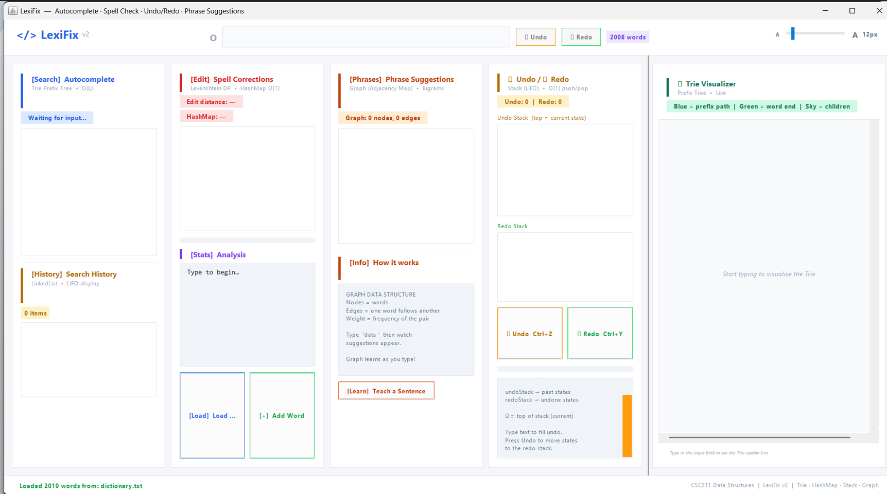
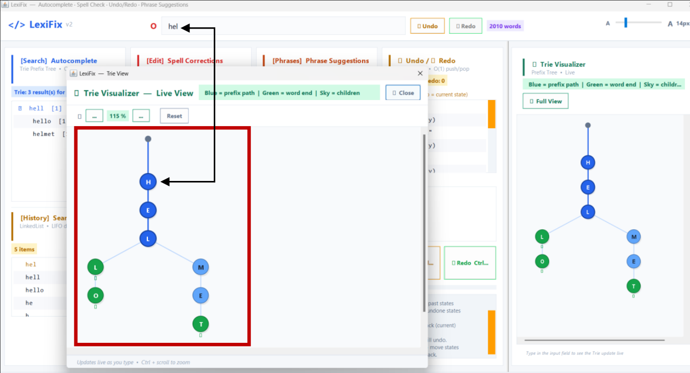
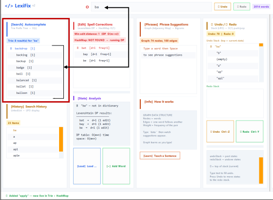
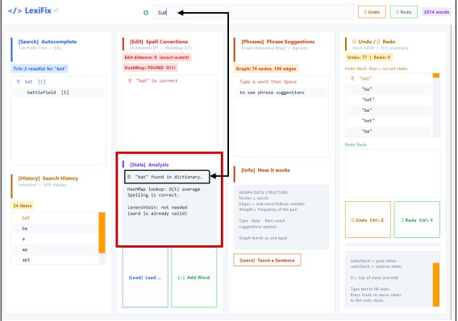
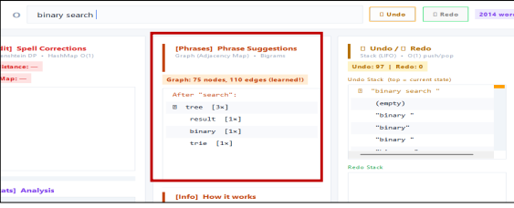

<div align="center">

# 🚀 LexiFix

### Intelligent Text Assistant & Interactive Trie Visualizer


**LexiFix** is a Java Swing desktop text assistant built to demonstrate how core **Data Structures and Algorithms** support practical text-processing features: prefix-based autocomplete, spell checking, edit-distance corrections, phrase suggestions, undo/redo history, and live Trie visualization.

</div>

---

## 🖥️ Application Showcase

### Main Workspace

A multi-panel desktop interface combining autocomplete, spelling analysis, phrase predictions, edit history, and live Trie visualization.

<p align="center"></p>

### 🌳 Live Trie Visualizer

A graphical view of the active prefix path and matching word branches. The interface distinguishes search paths, completed words, and child nodes.

<p align="center"></p>

### 🔎 Feature Highlights

| Trie Autocomplete | Spell Checking | Phrase Suggestions |
|:---:|:---:|:---:|
|  |  |  |
| Finds words matching a typed prefix. | Checks words and suggests edit-distance corrections. | Learns word transitions and ranks next-word candidates. |

---

## ✨ Key Features

- **Trie-based autocomplete** — retrieves matching words as the user types.
- **Dictionary validation** — checks whether a word exists in the loaded vocabulary.
- **Spell correction** — uses Levenshtein edit distance to find candidate corrections.
- **Phrase suggestions** — models consecutive-word relationships as a weighted, directed bigram graph.
- **Undo and redo** — stores previous text states in two LIFO stacks, with `Ctrl+Z` / `Ctrl+Y` shortcuts.
- **Search history** — displays recent queries in a linked-list-style history panel.
- **Live Trie visualization** — shows the active prefix path and branches in a graphical tree.
- **Interactive desktop UI** — modular Java Swing panels, status indicators, and text-size controls.

## 🧠 Data Structures & Algorithms

| Feature | Data structure / algorithm | Typical complexity |
|---|---|---|
| Exact word / prefix lookup | Trie | **O(L)** to traverse a word or prefix of length L |
| Enumerating autocomplete matches | Trie traversal | **O(L + visited subtree nodes)**, plus result handling |
| Dictionary membership | HashMap | **O(1)** average lookup |
| Levenshtein distance | Dynamic programming | **O(M × N)** time for words of lengths M and N |
| Phrase graph edge insertion | HashMap-based adjacency graph | **O(1)** average per edge update |
| Undo / redo | Two stacks | **O(1)** stack operations, excluding string copying |

> Complexity depends on the operation: collecting and ranking suggestions takes additional work beyond a prefix lookup. The table avoids treating full suggestion generation as a constant-time operation.

## 🛠️ Technology Stack

| Category | Technology |
|---|---|
| Programming language | Java |
| Desktop GUI | Java Swing / AWT |
| Core structures | Trie, HashMap, directed weighted graph, stacks |
| Algorithms | Prefix traversal, Levenshtein dynamic programming, bigram frequency ranking |
| Build and launch | `javac`, `java`, Windows batch / shell scripts |

## 📁 Repository Structure

```text
lexifix/
├── assets/                       # README screenshots
├── data/
│   └── dictionary.txt            # Vocabulary dataset
├── src/
│   ├── Main.java                 # Entry point
│   └── lexifix/
│       ├── engine/               # Trie, dictionary, suggestions, undo/redo
│       ├── model/                # TrieNode, WordEntry
│       └── ui/                   # Swing GUI, Trie visualization
├── run.bat                       # Windows build/run script
├── run.sh                        # Shell build/run script
├── .gitignore
└── README.md
```

Compiled output is generated in `out/` and excluded from version control.

## 🚀 Getting Started

### Prerequisites

Install a **Java Development Kit (JDK)** and confirm that `java` and `javac` are available in your terminal:

```bash
java -version
javac -version
```

### Windows (recommended)

From the project root, run:

```bat
run.bat
```

The batch script compiles the source into `out/` and launches the application.

### Linux / macOS

The included `run.sh` script may need its source-file list updated to include the newer `BigramGraph.java` and `UndoRedoManager.java` classes. Alternatively, compile all Java source files with your preferred build command before launching `Main`. The Windows script includes these classes.

## 🎓 Project Background

LexiFix is an academic **Data Structures and Algorithms** project that demonstrates how core data structures can be applied to an interactive desktop text assistant.

## 👨‍💻 Author

**Muhammad Talha Sultan**  
GitHub: [@talhasultan014](https://github.com/talhasultan014)

---

*Built with Java and Java Swing for hands-on exploration of Data Structures and Algorithms.*
